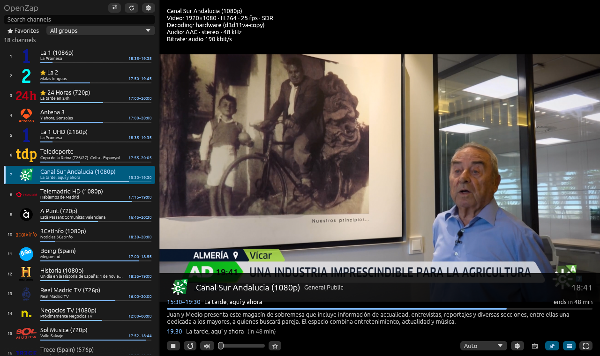

# OpenZap

Desktop IPTV player for Windows, Linux and macOS: HLS/HTTP streams, M3U playlists, XMLTV EPG.

**Status:** early development.



<sub>Screenshot: public channels from [iptv-org](https://github.com/iptv-org/iptv) with the
[iptv-epg.org](https://iptv-epg.org) guide.</sub>

## Features

- Open an M3U playlist and an optional XMLTV guide from a file or an HTTP(S) URL (`.gz` is supported)
- Downloaded playlists and guides are saved: update them on every start, once
  a day or only on demand; the saved copy is used when the server is down
- Search, filter by group, favorites
- "On air now" and "next" for every channel
- Video plays inside the main window (libmpv, OpenGL)
- Channel list on the left or right (or hidden); the programme guide and the
  controls slide up over the video
- Audio track and subtitle switching, picture size (aspect ratio, crop, stretch), always on top
- Dark, light or system theme
- Channel logos (`tvg-logo` from the playlist, otherwise the guide's channel
  icon), cached on disk for a week
- Programme times in local time
- Programme guide per channel: every programme by day, with descriptions
- Archive (catch-up): watch past programmes from the guide on channels whose
  provider keeps recordings (`catchup`, `tvg-rec`; shift, Flussonic and
  template schemes)
- Timeshift on those channels: pause, rewind and skip forward, jump to the
  start of a programme or the next one, back to live
- Time shift per channel for guides that run ahead of or behind the picture
  (also `tvg-shift` from the playlist)
- Channel numbers (`tvg-chno` or the position): type digits to switch
- Stream info: resolution, codecs, frame rate, HDR, hardware/software decoding, bitrate
- Channels whose sound cannot be decoded play on without it; failures name
  the server's answer (e.g. HTTP 502)

## Install

Download a file from the [Releases](../../releases) page.

- **Windows:** unpack the zip and run `openzap.exe`. `libmpv-2.dll` is included.
  The executable is not code-signed, so Windows SmartScreen may warn on first start.
- **Linux, Flatpak** (any distribution, Steam Deck; libmpv included):
  `flatpak install --user openzap-vX.Y.Z-x86_64.flatpak`, then start it from the
  application menu or with `flatpak run io.github.bolthp.OpenZap`. The runtime it
  needs comes from Flathub (added automatically if it is not set up yet).
  The first install downloads that runtime and its graphics drivers (several
  hundred MB, once; other Flatpak apps on the same runtime share it). If Flatpak
  itself was just installed, log out and back in: until then the application
  menu does not list Flatpak apps and the taskbar shows a generic icon.
- **Linux, tar.gz:** unpack and run `./openzap`. libmpv must be installed:
  `sudo apt install libmpv2` (Debian/Ubuntu; `libmpv1` on older releases).

OpenZap looks for libmpv next to the executable first, then in the system.

The tar.gz build adds itself to the application menu on first start
(`~/.local/share/applications/openzap.desktop` and its icon), so launchers and
the taskbar show its icon; the entry follows the executable if you move it.
Delete those two files to remove it.

## Usage

On first start the **Settings** dialog opens: enter the playlist (a URL, or
a file chosen with **Browse…**) and, optionally, the programme guide. Settings also hold
how often to update them, hardware decoding, the network buffer and whether to resume
the last channel on start.

The channel list appears as soon as the playlist is read; a big guide keeps
loading in the background. By default the playlist is downloaded on every
start and the guide once a day (also while the app keeps running); the reload
button in the channel list downloads both right away.

```sh
openzap                                   # sources from the settings
openzap playlist.m3u [epg.xml]            # or override them for this run
```

Settings (sources, volume, favorites, playback options) are stored in a
plain-text file: `~/.config/openzap/config.txt` on Linux,
`%APPDATA%\OpenZap\config.txt` on Windows. It can contain URLs with access
keys, so keep it private. The window size and position are kept next to it in
`window.ron`. Logos and saved copies of downloaded playlists and guides are
kept in `~/.cache/openzap` on Linux and `%LOCALAPPDATA%\OpenZap\cache` on
Windows (`logos`, `sources`); saved playlists may contain access keys too.
Copies of sources no longer in the settings are deleted after a load;
**Settings → Cache → Clear** deletes everything there.
The Flatpak keeps all of this in `~/.var/app/io.github.bolthp.OpenZap/`
(`config/openzap`, `cache/openzap`); on its first start it takes over the
settings of the tar.gz build, if there are any. It can read files in your home
folder; choose files elsewhere with **Browse…**.

## Keyboard

| Key | Action |
|---|---|
| click / double-click a channel | select / play it (right-click: favorites) |
| `Enter` | play the selected channel |
| digits | jump to the channel with that number (`tvg-chno`, or its position) |
| `Backspace` | back to the previous channel |
| `PageUp` / `PageDown` | previous / next channel |
| `F` / double-click video | fullscreen |
| `Esc` | leave fullscreen |
| `M` / mouse wheel over video | mute / volume |
| `L` | show / hide the channel list (fullscreen: keep it open) |
| `A` | next audio track (when the stream has several) |
| `S` | subtitles: off → each track → off (when the stream has any) |
| `Z` | picture size of this channel (remembered per channel): auto, 16:9, 4:3, fill (crop), stretch |
| `T` | always on top |
| `R` | restart the stream (also after "no picture for 20 s") |
| `G` | programme guide of the channel (`Esc` closes it) |
| `Space` | pause / resume |
| `←` / `→` | archive channels: back / forward 15 s (`Shift`: 1 min, `Ctrl`: 10 min) |
| `Home` | archive channels: start of the programme (again: the one before) |
| `End` | back to live |
| `I` | info: the programme in full (whole description, next) → stream info (resolution, codecs, HDR, decoder, bitrate) → off |

Moving the mouse over the video brings up the bar with the programme guide
and the controls; it hides again after a few seconds. The guide is for the
channel selected in the list (clicking a channel brings the bar up), or the
one playing if nothing else is selected. Opening the guide panel, or bringing
the list back, returns to the channel playing.
In fullscreen, moving the mouse to the window edge where the list belongs
slides it in over the video; it slides away when the mouse leaves it, unless
pinned with `L` or the list button.
In a window, drag the video (or any empty spot) to move the window.

Channels with an archive (catch-up) show `⏪` and its depth in days in the
list. In the guide (`G`), click a past programme and then **Watch**. While a
channel plays, the arrow keys, `Home`, the bar's buttons or a click on the
programme's progress line move through the archive; `End` or **Live** goes
back. A long pause on such a channel continues from the archive where it was
paused. The recordings stay on the provider's server; the archive can be
turned off in the settings.

If a channel's guide is ahead of or behind the picture, set **Time shift** at
the top of its guide panel (`−`/`+` move 5 min; drag or type for more). It
moves the programme times of that channel, and where the archive starts them,
and is remembered per channel. A `tvg-shift` (hours) in the playlist is used
as the starting value.

## Known issues

- **Wayland (the default on Ubuntu):** an application can neither keep its own
  window on top nor read or set its position, so *Always on top* is disabled
  (use the window menu: `Alt+Space` or right-click the title bar → *Always on
  Top*) and the window opens where the desktop places it; its size is kept.
  Both work in an X11 session, on Windows and on macOS.
- **Linux, first start:** the taskbar may show a generic icon until the second
  start of the tar.gz build (the desktop entry is created on the first one). The
  Flatpak does not have this problem.

## Troubleshooting

Start with `--debug` (on Windows: double-click `openzap-debug.bat`) to write
`openzap-debug.log` next to the executable (Flatpak: `flatpak run
io.github.bolthp.OpenZap --debug`, the log goes to
`~/.var/app/io.github.bolthp.OpenZap/config/openzap/`): GPU and OpenGL version, player
events, mpv's messages and a periodic check whether video frames arrive.
Stream URLs in the log are masked, but it may still contain channel names and
server host names — look through it before sharing.

## Build from source

Requires a stable Rust toolchain. libmpv is loaded at run time, so it is
not needed to build, only to run (and to run the playback tests).

```sh
cargo run --release
cargo test
```

The Flatpak (manifest in `flatpak/`, building libmpv and FFmpeg as well) is
built with `scripts/flatpak-build.sh`; it needs `flatpak` and `flatpak-builder`.

## Third-party software

Windows releases bundle `libmpv-2.dll` from
[shinchiro/mpv-winbuild-cmake](https://github.com/shinchiro/mpv-winbuild-cmake)
(a GPL build of [mpv](https://mpv.io) with FFmpeg); the exact version is pinned in
`scripts/fetch-libmpv-windows.ps1`. Sources are available from that project and from
the mpv and FFmpeg repositories. The Flatpak builds mpv, FFmpeg, libplacebo and
libass from source; their versions are pinned in `flatpak/io.github.bolthp.OpenZap.yml`.

## License

GPL-3.0-or-later — see [LICENSE](LICENSE).
